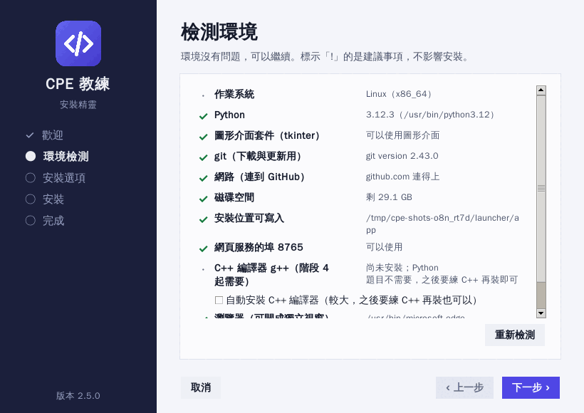
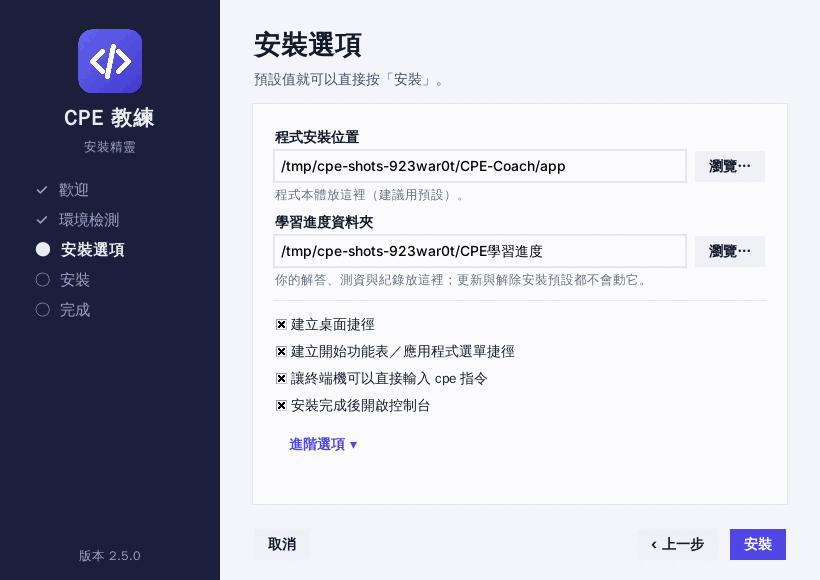
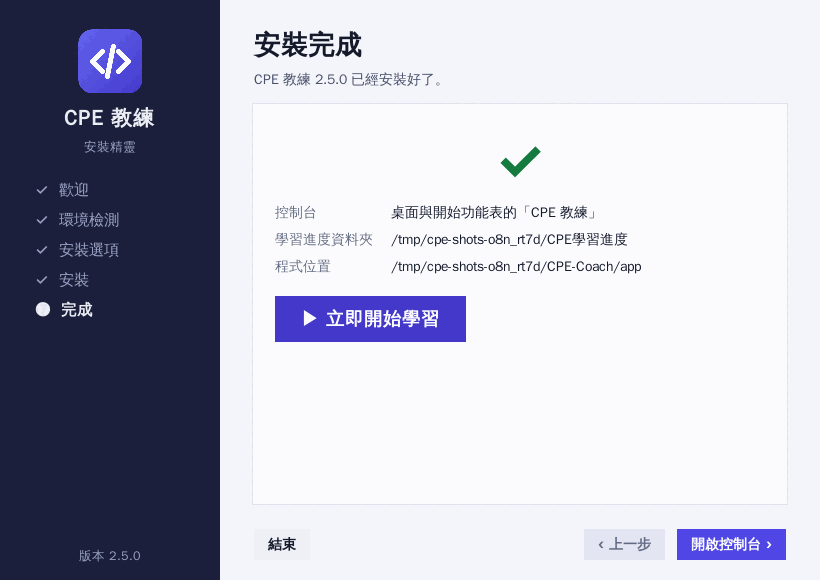
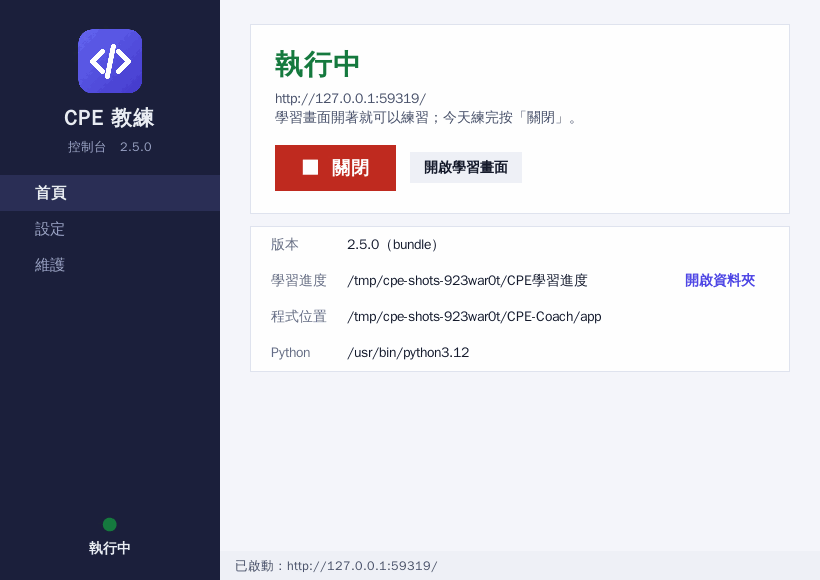
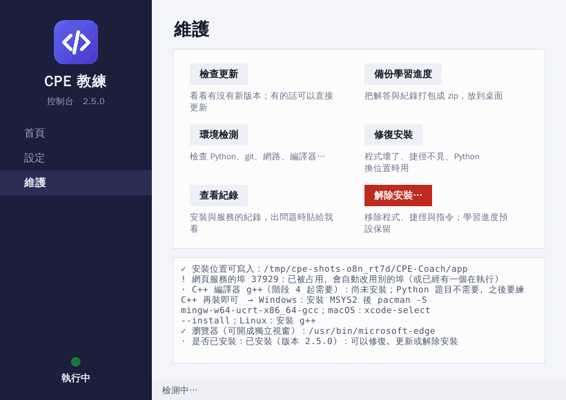
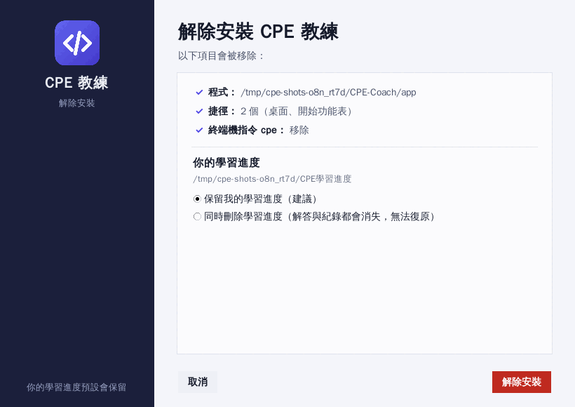

# 安裝、使用與更新教學

這份教學的安裝精靈已經做過的驗證（誠實版）：

- **Linux：** 在 GitHub 的 Linux 機器與開發環境都跑過整套流程——文字模式與圖形視窗（Python 3.9、3.12，用虛擬螢幕，由測試程式去按每一個按鈕）、從 git／下載 zip／本機資料夾三種來源安裝、更新、修復、解除安裝、開啟與關閉服務，並逐張檢視過截圖。
- **Windows（英文版）、macOS（Apple 晶片）：** 由 GitHub 的這兩種機器自動執行同一套單元測試（含圖形視窗），另外用雙擊用的啟動檔（Windows：`install-windows.bat`；macOS：它呼叫的 `setup/bootstrap.sh`）**從 GitHub 真的下載、安裝一次**，檢查桌面與開始功能表的捷徑（Windows 是真正的 `.lnk`，檔名含中文）、「應用程式與功能」的項目、PATH、`cpe` 指令，開啟與關閉服務，最後解除安裝並確認清乾淨、學習進度還在。
- **還沒驗證到的：** 我沒有在真人的 Windows／macOS 桌面上用滑鼠點過；也沒有在『完全沒有 Python 的乾淨電腦』上跑過『自動安裝 Python』那一步（winget、python.org 安裝程式、Homebrew、apt），GitHub 的機器都已經有 Python；`install-macos.command` 本身只跑了檢查模式。如果某一步和你看到的畫面不一樣，請按控制台的「維護 → 查看紀錄」，把內容貼給我。

## 先搞懂三個位置

| 位置 | 裡面是什麼 | 誰會改它 |
|---|---|---|
| **程式** | CPE 教練本體（預設放在控制台資料夾底下的 `app`） | 我（在雲端改完推上 GitHub），你按控制台的「檢查更新」或執行 `cpe update` |
| **學習進度資料夾**（預設：你的使用者資料夾裡的 `CPE學習進度`） | **你的進度**：解答、測資、提交紀錄、對話、單字本 | 只有你的練習會改它 |
| **控制台資料夾** | 設定檔、紀錄、`cpe` 指令、圖示 | 精靈與控制台 |

程式與進度**分開放**：更新、修復、重新安裝、解除安裝預設都不會動到進度。

| 作業系統 | 控制台資料夾 |
|---|---|
| Windows | `%LOCALAPPDATA%\CPE-Coach` |
| macOS | `~/Library/Application Support/CPE-Coach` |
| Linux | `~/.local/share/cpe-coach` |

## 一、安裝（三步，大約兩分鐘）

### 1. 下載

下載這個壓縮檔並**解壓縮**（解壓到你找得到的地方，例如「下載」資料夾；不要直接在壓縮檔裡面雙擊）：

<https://github.com/Kurihararyder/code-cc/archive/refs/heads/claude/clever-archimedes-ekcn2m.zip>

（目前的開發分支叫 `claude/clever-archimedes-ekcn2m`，還沒合併進 `main`，所以連結指定這個分支。）

### 2. 雙擊安裝檔

| 作業系統 | 檔案 | 做法 |
|---|---|---|
| **Windows** | `install-windows.bat` | 雙擊。Windows 可能跳出藍色的「Windows 已保護您的電腦」→ 按「**其他資訊**」→「**仍要執行**」（因為這個檔案是從網路下載的、沒有付費簽章） |
| **macOS** | `install-macos.command` | 第一次要**按右鍵 → 打開**（避開「無法驗證開發者」的擋門），再按「打開」；或在終端機執行 `sh install-macos.command` |
| **Linux** | `install-linux.sh` | 終端機執行 `sh install-linux.sh` |

啟動檔會先找電腦上有沒有 **Python 3.9 以上**；**沒有的話會問你要不要自動安裝**（Windows 用 winget，沒有 winget 就下載 python.org 的安裝程式並驗證雜湊值；macOS 用 Homebrew 或 python.org 的安裝程式；Linux 用套件管理員），只裝給你自己、Windows 不需要系統管理員。然後打開**安裝精靈**。

電腦上已經有 Python 3.9 以上的話，也可以直接雙擊資料夾裡的 `cpe-panel.pyw`（效果相同，已安裝就開控制台、還沒安裝就開精靈）。

只想看看電腦缺什麼、**不安裝任何東西**：Windows 在命令提示字元執行 `install-windows.bat -CheckOnly`；macOS／Linux 執行 `sh install-linux.sh --check`。

### 3. 跟著精靈走



1. **歡迎**：說明會做什麼。如果偵測到已經安裝，這裡可以直接「開啟控制台」、「修復」或「解除安裝」。
2. **檢測環境**（自動）：

   | 檢查 | 沒過會怎樣 |
   |---|---|
   | Python 3.9 以上 | 擋住安裝（啟動檔會先幫你裝） |
   | 網路（連得到 GitHub） | 擋住安裝；但如果你是從解壓縮的資料夾執行，會改用那份程式安裝（離線也能裝） |
   | 磁碟空間（至少 400 MB）、安裝位置可寫入 | 擋住安裝，並說明原因 |
   | git | 沒有也能裝（改用下載 zip）；**勾選「自動安裝 git」就幫你裝**（Windows：winget；macOS：Homebrew 或 Apple 的命令列工具；Linux：套件管理員，會請你輸入密碼） |
   | C++ 編譯器 g++ | 階段 4 起的 C++ 題目才需要；**可以勾選自動安裝**（Windows 會裝 MSYS2 並設好路徑，要下載約 300 MB），也可以之後再裝 |
   | 圖形介面套件 tkinter、網頁服務的埠 8765、Edge／Chrome | 只是參考；埠被占用會自動改用別的 |

3. **安裝選項**（預設值就可以直接按「安裝」）：程式位置、學習進度資料夾、要不要桌面捷徑／開始功能表捷徑／讓終端機可以輸入 `cpe`、安裝完成後是否開啟控制台。「進階選項」可以選程式來源（自動／git／下載 zip／本機資料夾）、連接埠、**從備份檔還原進度**（換電腦時用）。

   

4. **安裝**：進度條與紀錄。任何一步失敗，**這一次做的變更會全部復原**（電腦回到安裝前的樣子），並顯示原因與「複製診斷資訊」按鈕。可以按「取消」（會等目前這一步做完才停下來，然後把已經做的復原）。
5. **完成**：

   

   按「▶ 立即開始學習」或「開啟控制台」。

安裝會建立：程式、學習進度資料夾（已存在就沿用）、`cpe` 指令、桌面與開始功能表（Linux：應用程式選單；macOS：「應用程式」資料夾）的「CPE 教練」捷徑；Windows 另外會在「設定 → 應用程式 → 已安裝的應用程式」加一個項目，並把 `cpe` 指令加進你的使用者 PATH。

## 二、控制台：開啟、關閉、更新、備份、解除安裝

之後每天，**雙擊桌面或開始功能表的「CPE 教練」**就是控制台：



- **首頁**：大按鈕「▶ 開啟」會啟動學習服務並打開學習畫面（有 Edge 或 Chrome 就開成獨立的應用程式視窗，像桌面程式；否則用預設瀏覽器）；服務執行中時按鈕變成紅色「■ 關閉」。左下角的燈與文字就是狀態。用終端機自己打 `cpe web` 開的服務，控制台也認得、也關得掉。
- **設定**：開啟後要不要自動開畫面、要不要用獨立視窗、開控制台時是否自動啟動服務與自動檢查更新（有新版本時首頁會出現「立即更新」）、關閉控制台時服務怎麼處理（詢問／一併關閉／繼續執行）、連接埠。
- **維護**：

  

  - **檢查更新**：看有沒有新版本；有的話列出內容、問你要不要更新。更新時服務會先關閉、更新完自動重開、控制台自動重新啟動。
  - **備份學習進度**：打包成 zip 放到桌面。
  - **環境檢測**：再跑一次上面那張表。
  - **修復安裝**：程式壞了、捷徑被刪掉、Python 換了位置時用；會重新取得程式並重建捷徑，**不動進度**。
  - **查看紀錄**：安裝與服務的紀錄（出問題時貼給我）。
  - **解除安裝…**：見第六節。

不開控制台、直接開始學習：Windows 開始功能表裡有「CPE 教練　開始學習」；macOS／Linux 執行 `cpe-panel open`。

## 三、每天怎麼用

1. 雙擊「CPE 教練」→ 按「▶ 開啟」。
2. 首頁的「今日計畫」會排出今天要做的題。點第一題 `d001`。
3. 左邊是題目、中間寫程式、按「執行測試」（或 `Ctrl+Enter`）判題。卡住再用「提示階梯」，用了提示的題目隔天要無提示重寫。
4. 在題目、程式或測試結果上**選取一段文字**，旁邊會問「要問這一段嗎？」（需要金鑰，見下一節）。
5. 想模擬考場：左側「考試」頁。
6. 今天練完，回到控制台按「■ 關閉」（或直接關控制台，它會問你要不要順便關閉服務）。

終端機版也有完整功能：`cpe today`、`cpe new d001`、`cpe test d001`、`cpe plan -m 30`……`cpe --help` 看全部。（網頁服務只綁在你自己的電腦上，別人連不進來。）

## 四、設定 AI（選用）

「選取文字問 AI」會把你的程式與題目敘述傳給 OpenAI，並產生 API 費用（每次約一兩千 token）。

- **最簡單**：網頁右上角（或「設定」頁）貼上 OpenAI 金鑰，按「測試連線」。金鑰只存在這個程式的記憶體，不寫入任何檔案，每次重開要再貼。
- **環境變數**（重開不用再貼）：開啟服務前設定 `OPENAI_API_KEY`。
  - PowerShell：`$env:OPENAI_API_KEY="sk-..."`，再用同一個視窗執行 `cpe-panel`
  - macOS／Linux：`export OPENAI_API_KEY=sk-...` 後執行 `cpe-panel`
- 建議在 OpenAI 後台為這把金鑰設花費上限。
- 想評測 AI 詢問系統的表現：`cpe ai-eval --yes`（會呼叫約 20～40 次 API）。

## 五、更新（我在雲端改好之後，你在電腦上做）

最簡單：控制台 → **維護 → 檢查更新**。或在終端機：

```bash
cpe update --check    # 只看有沒有新版本（不會改程式檔）
cpe update            # 更新，並顯示這次更新的內容
```

網頁的「設定 → 版本與更新」也有「檢查更新」按鈕（只檢查）。

- 用精靈安裝時預設是 **git** 來源：只做 fast-forward 的 `git pull`；更新後會用新程式重新載入一次，**載入失敗會自動退回更新前的版本**。你改過程式資料夾裡的檔案、或有沒推送的 commit 時不會更新並告訴你為什麼（所以不要直接改程式資料夾裡的檔案，要改請告訴我）。
- 沒有 git 的電腦會用 **下載 zip** 來源：重新下載、驗證新版能載入才整個換掉，失敗就保留舊版。
- 更新不碰你的學習進度；舊版建立的工作區會繼續能用（有自動測試，用 1.0.0 與 2.1.0 實際產生的工作區驗證過）。想更保險，更新前先在控制台按「備份學習進度」。
- 之前用 `git clone` ＋ `pip install -e .` 手動安裝的人：`cpe update` 照樣能用（更新到 2.5.0 之後，程式資料夾裡就有 `install-windows.bat` 等安裝檔）。想改用精靈：雙擊安裝檔，**在「安裝選項」把「學習進度資料夾」選成你原來的資料夾（例如 `my-cpe`），進度會原封不動沿用**；裝好確認一切正常後，舊的 `code-cc` 資料夾可以刪除，並執行 `python -m pip uninstall cpe-coach` 移除舊的 `cpe` 指令。

## 六、解除安裝

三種做法任選：

1. 控制台 → **維護 → 解除安裝…**
2. Windows：「設定 → 應用程式 → 已安裝的應用程式」→ CPE 教練 → 解除安裝；或開始功能表的「解除安裝 CPE 教練」
3. 再執行一次安裝檔（偵測到已安裝會顯示「解除安裝」）；或終端機 `cpe panel`



會移除：程式、桌面與開始功能表捷徑、`cpe` 指令與 PATH、Windows「已安裝的應用程式」裡的項目、控制台資料夾（設定與紀錄）。服務有開著會先關閉。
**你的學習進度預設保留。** 如果選「同時刪除學習進度」：要勾選「我了解刪除後無法復原」，預設會先把進度備份成 zip 放到桌面。

因為控制台正在使用程式資料夾，所以最後的刪除是由一個獨立的小程序在控制台關閉之後做的（幾秒鐘）。

## 七、備份與搬家

控制台 → 維護 → 備份學習進度；或 `cpe export`（不含 API 金鑰）。系統每小時還會自動留一份進度快照（學習進度資料夾裡的 `.cpe/backups`）。
換電腦：新電腦照「一、安裝」，在精靈的「進階選項 → 還原備份」選備份檔；或之後 `cpe restore 備份檔.zip --dir 新資料夾`。

## 八、疑難排解

| 狀況 | 怎麼辦 |
|---|---|
| 啟動檔說找不到 Python、也沒辦法自動安裝 | 到 <https://www.python.org/downloads/> 安裝（Windows 勾選 **Add python.exe to PATH**），再雙擊一次安裝檔 |
| Windows：跳出「Windows 已保護您的電腦」 | 「其他資訊」→「仍要執行」；這是因為檔案從網路下載且沒有付費簽章 |
| macOS：「無法打開，因為無法驗證開發者」 | 按右鍵 → 打開 → 打開；或系統設定 → 隱私權與安全性 → 仍要打開；或終端機 `sh install-macos.command` |
| 沒有出現圖形視窗、跑出文字選單 | 這個 Python 沒有 tkinter（Linux 裝 `python3-tk`；macOS 建議用 python.org 的 Python）或沒有圖形畫面。文字模式功能一樣；`--text` 可以強制用文字模式 |
| 埠 8765 被占用 | 不用處理：控制台會自動改用別的埠（網址會顯示在首頁）；想固定用別的，在「設定」改連接埠 |
| 瀏覽器沒有自動開 | 控制台首頁按「開啟學習畫面」，或手動貼上首頁顯示的網址 |
| 提示「找不到 g++」 | 只有 C++ 題目需要：控制台 → 維護 → 環境檢測；或重新執行安裝檔，在檢測頁勾選「自動安裝 C++ 編譯器」。Windows 手動：安裝 MSYS2（<https://www.msys2.org/>），在它的終端機執行 `pacman -S mingw-w64-ucrt-x86_64-gcc`（程式也會自動找 `C:\msys64` 底下的 g++） |
| 升級了 Python 之後，桌面捷徑打不開 | 重新執行安裝檔，選「修復」（會改用目前的 Python 並重建捷徑） |
| 「檢查更新」說不是 git 安裝／連不上 GitHub | 看訊息：連不上通常是網路、公司或學校的代理擋掉 github.com；zip 安裝的人要有網路才查得到 |
| `cpe update` 說程式檔被修改過 | 在程式資料夾執行 `git status` 看改了哪些；不需要就 `git checkout .`，要保留就 `git stash` |
| 提示「已有進行中的考試」 | `cpe mock finish` 交卷，或在網頁「考試」頁交卷 |
| 進度檔壞掉 | 程式會自動從 `.cpe/state.json.bak` 還原並寫一份 `recovered.txt` 說明；還救不回來就用備份還原 |
| 防毒或防火牆跳出提示 | 網頁服務只綁 `127.0.0.1`（本機），不對外；允許即可 |
| 安裝失敗 | 精靈已把這次的變更復原。按「複製診斷資訊」貼給我；或看 `控制台資料夾/logs/launcher.log`；終端機 `cpe doctor` 會印出完整的環境與安裝狀態 |

## 九、進階：指令列與手動安裝

精靈的所有功能都有指令列版本（沒有圖形畫面的伺服器、自動化腳本用）：

```bash
python cpe-panel.pyw install --yes --text                 # 不詢問、全用預設值安裝
python cpe-panel.pyw install --yes --source zip --dir D:\CPE\app --workspace D:\CPE\進度 --no-desktop --no-path
python cpe-panel.pyw open [--no-browser]                  # 啟動服務並開啟畫面
python cpe-panel.pyw close | status [--json] | doctor
python cpe-panel.pyw update [--check] | repair
python cpe-panel.pyw uninstall --yes [--remove-workspace --backup-dir 資料夾]
```

安裝後同樣的功能也在 `cpe panel`、`cpe doctor`、`cpe update`。

不想用精靈、要自己管：

```bash
git clone -b claude/clever-archimedes-ekcn2m https://github.com/Kurihararyder/code-cc.git
cd code-cc && python -m pip install -e .      # macOS／新版 Linux：先 python3 -m venv ~/.cpe-venv 並啟用
cd .. && cpe init my-cpe && cd my-cpe && cpe web
```
