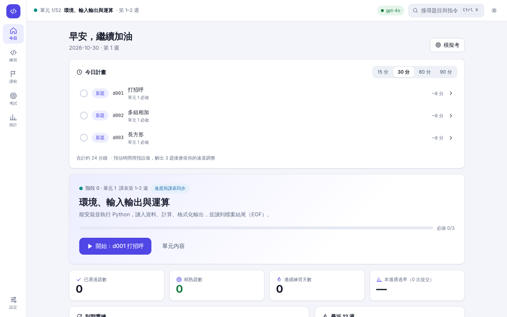
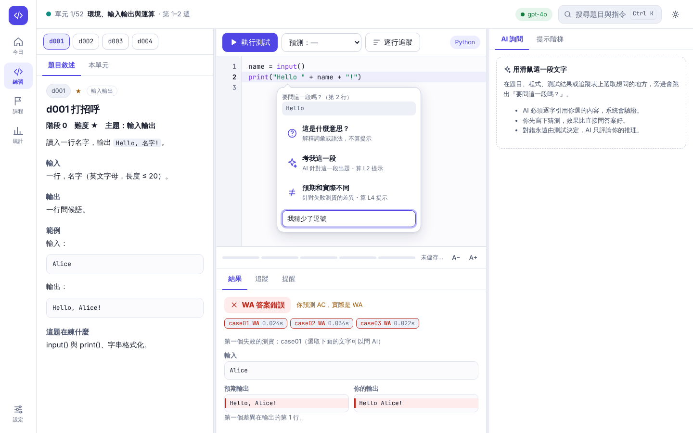
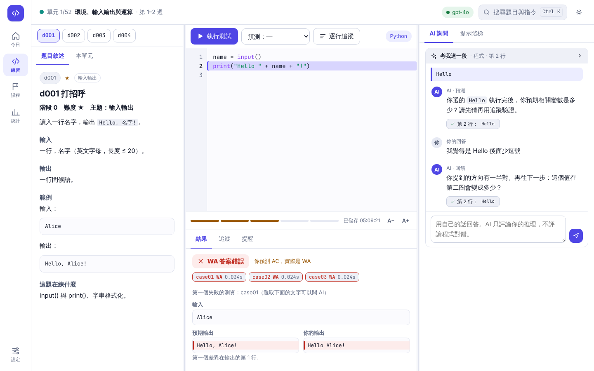
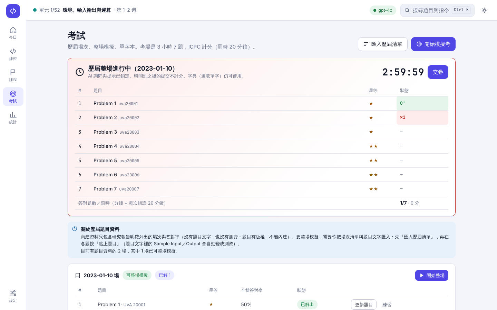

# CPE 自學教練

零基礎 → CPE 一次 6 題 → 工程師。包含：

- **126 週完整課程**（52 個單元、6 個階段）：[COURSE.md](COURSE.md)
- **107 題原創練習題**，題目敘述與測資都已內建，不用上網找題就能從第一天開始練
- 本機網頁介面（選取文字 → 問 AI）、本地判題、提示階梯、間隔重練、單元檢核、模擬考、對拍、統計
- 考試擬真（ICPC 計分板、歷屆整場、英文題目、字典與單字本）、依你的實際解題紀錄校準難度、「今天 N 分鐘」自動計畫、有自動驗收的工程任務、備份與搬家

研究依據：[docs/research-report.md](docs/research-report.md)。只需要 Python 3.9+（階段 4 起需要 g++），沒有第三方套件。

## 開始

```bash
pip install -e .          # 之後就有 cpe 指令（或用 python -m cpe_coach）
cpe init my-cpe && cd my-cpe
cpe today                 # 今天該做什麼
cpe course                # 目前單元：要學什麼、必做題、教材、陷阱、檢核
```

## 網頁介面（建議用這個）

```bash
cpe web                   # 在瀏覽器開啟 http://127.0.0.1:8765/
```



六個頁面：**今日**（今日計畫、目前單元、下一題、到期重練、連續天數、近 12 週熱度圖、考試倒數）、**練習**（題目／程式／AI 三欄，可拖曳調寬）、**課程**（52 個單元的地圖，點開看內容、跳關；另有「工程任務」分頁）、**考試**（歷屆場次、計分板、單字本）、**統計**（含難度校準）、**設定**（含下載備份）。
按 `Ctrl/⌘ + K` 開指令面板，可搜尋題號或跳頁；按 `?` 看全部快速鍵。支援淺色／深色，手機有底部導覽與分頁式工作區。

### 選一段文字，問 AI

右上角（或「設定」頁）貼上你的 OpenAI API 金鑰（只存在這個程序的記憶體，不寫入任何檔案；也可以先 `export OPENAI_API_KEY=...`），模型欄填你帳號可用的聊天模型，按「測試連線」確認。



在題目敘述、程式碼、測試結果或逐行追蹤表上選一段文字（手機：長按），旁邊會問「要問這一段嗎？」：

- **這是什麼意思？** 只解釋詞彙或語法的一般意義，不算提示，任何時候都能用。
- **考我這一段。** AI 針對你選的那段出題（預測值、指出哪一行、構造反例、估算次數）。算 L2 提示，要先跑過一次測試。
- **預期和實際不同。** 針對失敗測資的第一個差異發問。算 L4 提示，只在最近一次失敗時可用。



- **問題釘在細節上，而且可驗證。** AI 必須逐字引用你的程式或題目，系統檢查引用真的存在（模型把來源標錯會自動更正）：不存在就要求重答，仍不行會標「⚠ 無法驗證」。點引用標籤，編輯器會直接標出那一行。
- **你要先產出。** 彈出選單裡可以先寫下你的猜測；回覆 AI 的追問不限次數，它只評論你的推理，不評論程式對錯（對錯永遠是測資）。
- **不用 AI 的細節工具：** 逐行追蹤（先在心裡猜變數，再看）、失敗時標出出錯的那一行、失敗測資的差異高亮、常見陷阱提醒（`[[0]*C]*R`、`sum` 蓋掉內建函式、`list.pop(0)` 很慢…）、測試前先「預測結果」（統計你的預測準確度）。
- **提示階梯** 也在這裡：L0–L4，每一級要先有新的嘗試才能解鎖；放棄一題要冷卻 24 小時才能看解法講解。
- **考試流程完整：** 在「今日」按「開始單元檢核」或「模擬考」→ 倒數計時、AI 與提示自動鎖定 → 交卷 → 通過就自動進入下一單元。

注意：按下詢問時，**你的程式與題目敘述會傳給 OpenAI**，並產生 API 費用（每次約一兩千 token）。伺服器只綁 127.0.0.1，POST 需要一次性 token，檢查 Host／Origin，並使用嚴格的 CSP（沒有 inline script／style、不載入任何外部資源），防止其他網頁偷打這個本機服務。

## 考試擬真與歷屆題



- **計分板**：照 ICPC 規則——先比答對題數，再比罰時（每題 = 通過的分鐘 + 通過前每次錯誤 20 分鐘；沒通過的題目不罰）。語法錯誤（CE）不計罰時，時間到之後的提交不計分。
- **整場歷屆模擬**：考試頁選一場，照原本題序出 7 題、180 分鐘、AI 與提示鎖定。交卷後會告訴你歷年考生（2015–2024）中答對這麼多題的比例。
- **比照考場**：開始模擬考時勾選，只出「有英文題目文字」的題目（內建練習題是中文，所以不會出）。
- **字典與單字本**：在英文題目上雙擊一個單字 → 跳出的選單可以「查字典」（Cambridge 英漢，新分頁）或「加入單字本」。考試中字典仍可用，AI 仍鎖定。單字本可匯出 CSV。
- **每一題歷屆題都會用到**：匯入的題目依「全體答對率」換成星等（≥15% ★1、≥2% ★2、≥0.5% ★3、其餘 ★4，**官方答對率會取代我估的星等**），並依答對率分配到單元 15、16、25、47–51 當延伸練習（單元頁會列出，`cpe plan` 也會在必做題完成後排進去），隨機模擬考與檢核也會從中選題。

### 歷屆資料要自己匯入（我沒辦法替你抓）

歷屆題目有版權，而且我實際嘗試時 CPE 官網與成功大學／中山大學的題庫站都被這個環境的網路政策擋住（連線被拒），所以**內建的只有研究報告明確列出的資料**：2020-10-20 場的 7 題標題與答對率（其中 2 題報告沒有 UVA 題號，我沒有亂補；其餘題號也標為「待核對」）、近幾場的平均答對題數、以及 2015–2024 的答對題數分布。你有題目之後：

```bash
cpe past import 清單.csv         # 每行：date,order,uva,title,accuracy（可從試算表貼上）
cpe past statements 資料夾/       # 資料夾內的 uva10050.txt／.html…：存下題目並把 Sample Input/Output 變成測資
cpe past list                     # 每場的準備程度（題目、測資、是否英文）
cpe past start 2020-10-20         # 整場開始（沒有測資的題要加 --partial 才會略過）
cpe vocab list / cpe vocab export # 單字本
```

網頁的「考試」頁有同樣的功能（匯入歷屆清單、各題「貼上題目」，貼 HTML 也可以）。**只有題目裡的範例會變成測資**，通過範例不代表一定正確；請再用 `cpe addtest` 補自己的測資。

## 今日計畫、難度校準、工程任務

- **今日計畫**（首頁，或 `cpe plan -m 30`）：選 15／30／60／90 分鐘，自動排出「到期重練 → 做到一半的題 → 歷屆題／新題 → 單元檢核 → 每週無 AI 測驗 → 每週一次工程任務」。放不下的會列在「另外安排」。預估時間先用預設值（★1 約 8 分、★2 約 20 分、★3 約 45 分、★4 約 90 分），解出 3 題後依你的速度調整。
- **難度校準**（統計頁，或 `cpe calibrate`）：用你「到第一次通過為止」的實際投入（工作分鐘 + 每多一次嘗試 4 分 + 每次提示 6 分）換成星等，和題目標示並排。這是很粗的估計——資料少、也受當天狀態影響——所以只用來調整計畫的時間預估，不會改動題目的標示。
- **工程任務**（課程頁的「工程任務」分頁，或 `cpe eng`）：11 個任務，每個都有範本和**自動驗收**，通過才算完成，不能自己打勾。例如任務 3「為 3 題寫 pytest」：驗收會真的跑你的測試，並把你的解答改壞（把 `+` 換成 `-` 之類）確認測試會變紅，只會 `assert True` 的測試過不了。沒裝 pytest 時用內建的簡易執行器。需要證據的任務（開 PR、部署）要貼網址，格式不對會被拒絕——但**網址是否真的存在我不會去檢查**。

```bash
cpe eng start 3     # 建立 eng/solhelp.py、eng/test_solutions.py 範本
cpe eng verify 3    # 驗收；通過才標記完成
```

## 備份、搬家、多人

- 設定頁「下載備份」或 `cpe export`：把進度、解答、測資、對話、單字本打包成 zip（不含 API 金鑰）。換電腦：`cpe restore 檔案.zip --dir 新資料夾`；目標已有工作區時要加 `--force`（舊的 `.cpe` 會先改名保留）。還原時會擋掉會寫到資料夾外面的路徑。
- 每次存檔都是原子寫入並保留 `.bak`；進度檔壞掉會自動從 `.bak` 還原（並寫一份 `recovered.txt` 說明）。另外每小時自動留一份快照（`.cpe/backups/`，保留最近 24 份）。
- 多個程序（例如網頁和終端機同時開）用檔案鎖互斥，不會互相覆蓋進度。
- **多人**：沒有帳號系統。要幾個人各自練，就各自 `cpe init` 一個工作區（`cpe web --port` 用不同埠）；進度是各自的純文字檔。

## 執行限制與相容性

- 你的程式在子行程中執行：Linux／macOS 上有記憶體上限（預設 1024 MB，`config.json` 的 `memory_mb`）、輸出上限（32 MB）、超時就連同子行程一起殺掉；超過記憶體顯示 **MLE**。Windows 用 Job Object 限制記憶體。
- 支援 Python 3.9+（考場是 3.9.6）：我在 3.9.25 與 3.13 上跑過全部單元測試。`.github/workflows/ci.yml` 設定了 Linux／macOS／Windows × Python 3.9／3.12 的矩陣測試。

## 每天的流程（終端機版）

```bash
cpe new d001              # 安裝題目＋測資，建立 solutions/d001.py
cpe statement d001        # 讀題目
cpe test d001             # 本地判題（AC / WA / PE / TLE / RE / CE）
cpe hint d001             # 卡住才用；先改一版、cpe test 後才能升下一級
cpe giveup d001           # 真的不行：24 小時後 cpe solution 才看得到
cpe review                # 到期的『無提示重寫』；重寫用 cpe new d001 --fresh
```

完成單元的必做練習後：

```bash
cpe gate                  # 單元檢核：限時、空白檔、鎖定提示
# 寫完每題 cpe test，然後：
cpe mock finish           # 交卷。通過就自動進入下一個單元
```

其他：`cpe course list`（全部單元）、`cpe course goto N`（已有基礎可跳關）、`cpe mock start`（7 題 3 小時模擬考）、
`cpe mock start --kind weekly`（每週重寫舊題；加 `--real` 只出英文題）、`cpe stats`、`cpe plan`、`cpe calibrate`、`cpe eng`（工程任務）、`cpe stress`（對拍）。

## 課程怎麼運作

| 階段 | 週 | 內容 | 真實 CPE 目標 |
|---|---|---|---|
| 0 | 1–12 | Python 語法基礎 | — |
| 1 | 13–28 | 競程 I/O、一顆星題型 | 2 題（首次報考） |
| 2 | 29–44 | 排序／二分／雙指標／stack／heap／貪心／回溯 | 3 題 |
| 3 | 45–70 | 圖論、DP、數論 | 4 題 |
| 4 | 71–100 | C++、STL、計算幾何、進階圖論／字串／DP | 5 題 |
| 5 | 101–126 | 考試策略、弱點修補、低答對率題、全真模擬 | 6 題 |

每週：新概念 → 練習 → 真題 → **重寫日** → 計時檢核 → 休息。階段 2 起加上每週 20–30% 的工程任務。

**題目從哪來**
- `d001–d095`：階段 0–4 的必做練習，原創。
- `e101–e403`：**驗收專用**題，練習單元不會出現，階段檢核與模擬考才用。
- `uva…`：經典 UVA 真題（選做）。題目敘述請到 vjudge／UVA／瘋狂程設閱讀，把題目文字存成檔案後 `cpe import uva10041 題目.txt`，會自動抓 `Sample Input / Output`（或『範例輸入／輸出』）建成測資。

## 誠實的限制

- **6 題是全國前 1% 的成績。** 課程涵蓋需要的知識並用檢核擋住『以為學會了』，但不能保證你一定達成；**真實 CPE 成績才是最終檢核**。每個階段結尾都安排一次真實報考。卡在平台期延長 6–12 個月很正常。
- 課程內的難度星等、模擬考是我自己估的；官網連不上，沒能核對『官方一顆星選集 49 題』與 CPE26 選集，請自行到 [CPE 官網](https://cpe.mcu.edu.tw/) 取得後用 `cpe import` 加入。**歷屆題目與官方答對率只有報告列出的那一場**，其餘要照上面「歷屆資料要自己匯入」自己匯入。
- **Windows 與 macOS 我沒有實機測過。** Windows 的記憶體限制（Job Object）和檔案鎖是照文件寫的，沒有在 Windows 上跑過；Linux 上的版本有測試。請看 CI 的結果，有問題請告訴我。
- 難度校準與每日計畫的時間預估是粗略的啟發式，沒有拿多個真實學習者的資料驗證過。
- `uva…` 真題的題號／標題憑記憶整理（約 120 題），部分沒有內建提示（標為 `unverified`）；請以 vjudge 連結上的題目為準，發現錯誤用 `cpe add` 覆蓋。
- 教材不是我寫的：每個單元指向免費教材與章節（Python 官方教學、Competitive Programmer's Handbook、CP-Algorithms…），章節編號以書中目錄為準。
- **AI 詢問部分我用假的 OpenAI 伺服器完整測過流程（桌面＋手機瀏覽器自動化測試、無障礙檢查），但沒有拿真的 API 金鑰測過。** 若你的模型回傳格式不守規矩，系統會標示無法驗證而不是照單全收；有問題請告訴我。
- 內建練習題的期望輸出由參考解產生，並經暴力解交叉驗證；但仍可能有我沒發現的問題，發現請告訴我。
- 「暴力解會超時」的說法我實測過（見各題『這題在練什麼』），但超時與否和你的電腦速度有關；`config.json` 的 `timeout_sec` 可調。

## 提示（選用 AI）

沒有金鑰也能完整使用（L1、L2 是內建提示；L0、L3、L4 退回自助清單）。要 AI 提示：

```bash
export OPENAI_API_KEY=...      # 或 ANTHROPIC_API_KEY
export CPE_MODEL=...           # 可選，預設 gpt-4o / claude-sonnet-5-5
```

用 ChatGPT 網頁的話，看 [gpt/README.md](gpt/README.md)。AI 的回饋可能有誤（研究約 37%），**對錯只看測資**。

## 資料在哪

全部在工作區的 `.cpe/`（`state.json` 進度、`events.jsonl` 每次提交與提示的紀錄、`config.json` 設定、`past_exams.json` 你匯入的歷屆清單、`vocab.json` 單字本、`chats/` AI 對話），純文字，可以 git 備份，也可以用上面的 `cpe export`。

## 開發

```bash
python -m unittest discover -s tests -v     # 118+ 個單元測試（含判題限制、鎖、備份、歷屆、計畫、工程驗收、網頁 API）
# 介面端到端測試（Playwright）見 dev/ui_e2e/README.md
python dev/gen_drills.py && python dev/gen_course.py   # 重新產生題目與課程（dev/ 內含參考解，學習者請勿閱讀）
```
